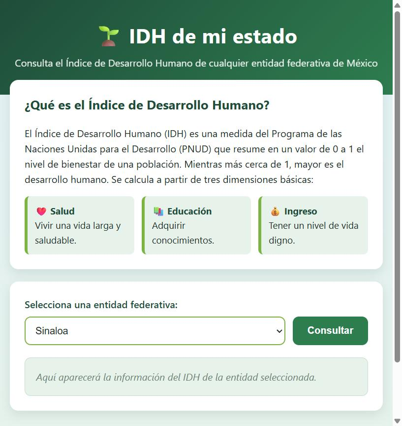
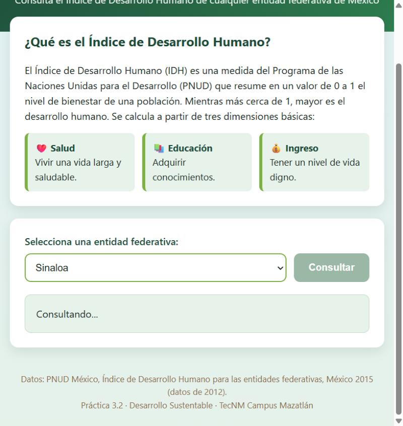
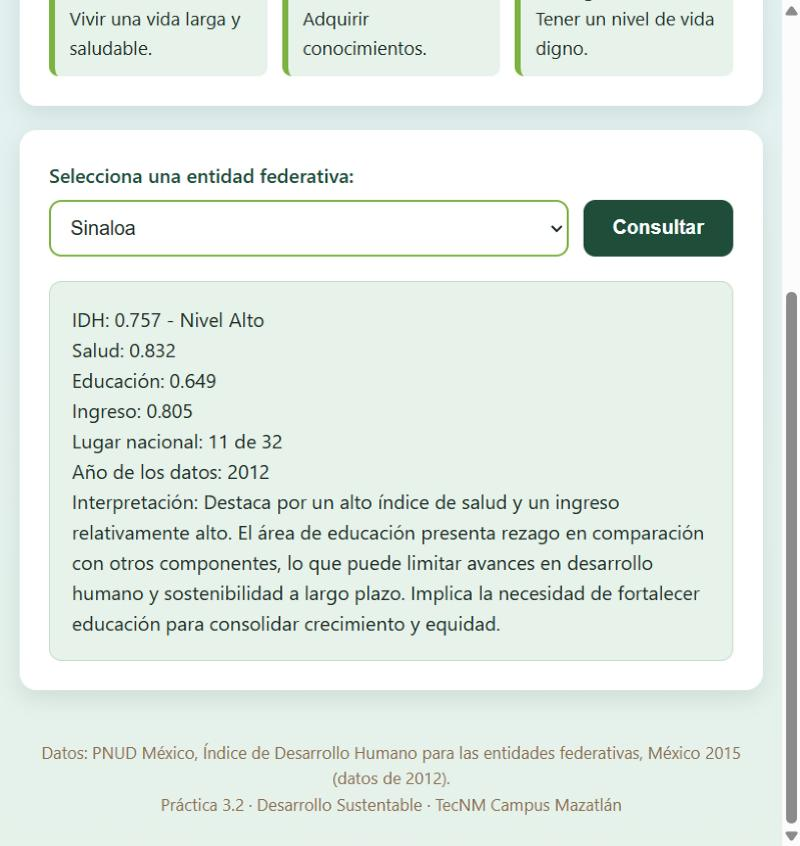
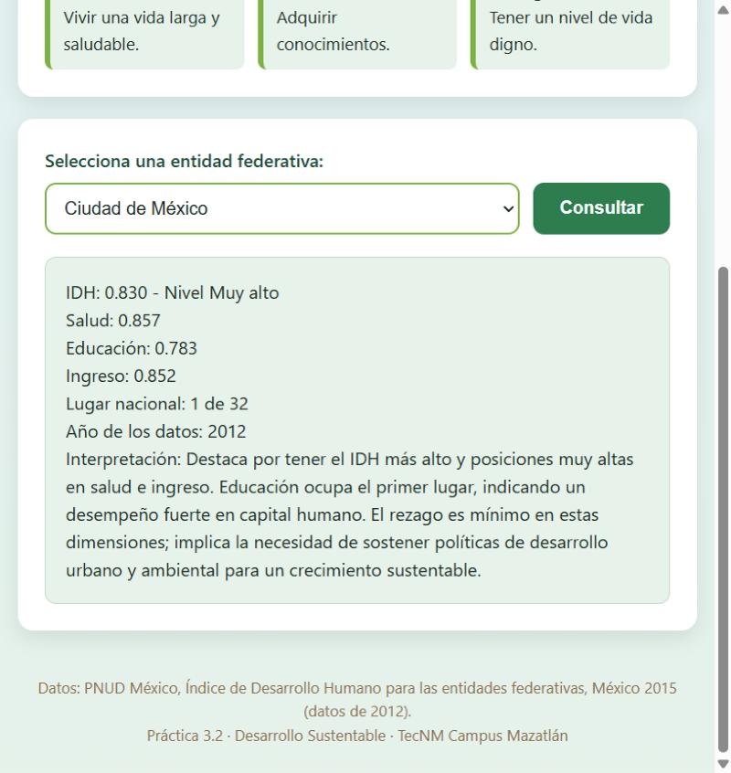
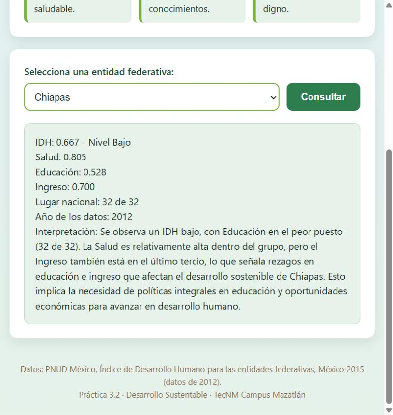
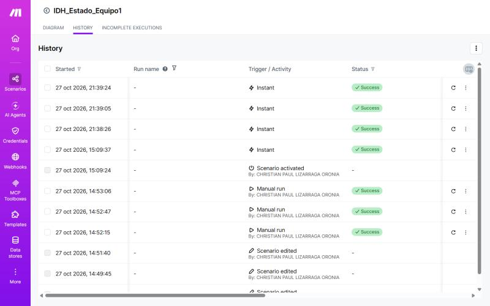
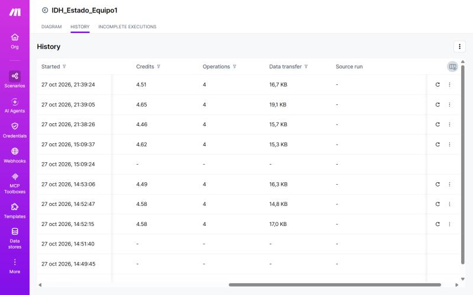

# IDH de mi estado

**Materia:** Desarrollo Sustentable · 3er semestre
**Carrera:** Ingeniería en Sistemas Computacionales — Instituto Tecnológico de Mazatlán
**Profesor:** Miguel Ángel Barrón Hernández
**Alumno:** Christian Paul Lizárraga Oronia
**Práctica:** 3.2 Cultura, diversidad socio-cultural · Unidad 3. Escenario socio-cultural

---

## 1. Descripción del proyecto

Se construyó una página web llamada **"IDH de mi estado"**, publicada con **GitHub Pages**, conectada a un escenario de **Make.com** con un **agente de inteligencia artificial**. Cualquier persona elige una entidad federativa de México y recibe, en segundos:

- El **Índice de Desarrollo Humano (IDH)** de la entidad y su nivel (muy alto, alto, medio o bajo).
- Los índices de **salud**, **educación** e **ingreso**.
- Su **lugar nacional** entre las 32 entidades y el año de los datos.
- Una breve **interpretación** de en qué destaca, dónde tiene rezago y qué implica para su desarrollo sustentable.

La IA responde **únicamente con los datos oficiales del PNUD** que se le dieron como conocimiento. El objetivo es interpretar el IDH de las entidades de México y **verificar que la información generada por la IA sea fiel a la fuente**.

🌐 **Página publicada:** [christiac507.github.io/IDH-de-mi-estado/codigo/](https://christiac507.github.io/IDH-de-mi-estado/codigo/)

**Video de la prueba en vivo:** [▶️ Ver video en YouTube](ENLACE_YOUTUBE)

## 2. Estructura del repositorio

```
├── README.md                        ← este reporte técnico
├── codigo/
│   ├── blueprint.json               ← exportación del escenario de Make.com
│   ├── index.html                   ← página web (GitHub Pages)
│   └── IDH_entidades.pdf            ← archivo de Knowledge del agente de IA
├── imagenes/
│   ├── 01_escenario_completo.jpg
│   ├── 02_pagina_publicada.jpg
│   ├── 03_consultando.jpg
│   ├── 04_resultado_sinaloa.jpg
│   ├── 05_resultado_cdmx.jpg
│   ├── 06_resultado_chiapas.jpg
│   ├── 07_historial_ejecuciones.jpg
│   └── 08_historial_creditos.jpg
├── video/
│   ├── enlace.txt                   ← link de YouTube con la prueba en vivo
│   └── enlace.md                    ← mismo link, clickeable
└── resultados/
    └── Resultados_IDH_de_mi_estado.pdf
```

## 3. Investigación de conceptos (Actividad 1)

**Desarrollo humano.** Es el proceso de ampliar las opciones y capacidades de las personas para que puedan vivir la vida que valoran. No se mide solo por cuánto dinero hay en una economía, sino por lo que la gente realmente puede ser y hacer: tener salud, aprender y contar con recursos para una vida digna.

**Índice de Desarrollo Humano (IDH).** Indicador del PNUD que resume en un valor de 0 a 1 tres dimensiones básicas:
- **Salud** (Índice de Salud): vivir una vida larga y saludable, medida con la esperanza de vida al nacer.
- **Educación** (Índice de Educación): adquirir conocimientos, medida con los años promedio y los años esperados de escolaridad.
- **Ingreso** (Índice de Ingreso): tener un nivel de vida digno, medido con el ingreso per cápita en dólares PPC.

El IDH es la media geométrica de los tres índices; mientras más cerca de 1, mayor desarrollo humano.

**Índice de desarrollo social / Índice de rezago social (CONEVAL).** El CONEVAL calcula en México el Índice de Rezago Social, que resume carencias en educación, acceso a servicios de salud, servicios básicos y calidad y espacios de la vivienda, y bienes en el hogar. A diferencia del IDH, mide **carencias** (mientras más alto, peor) y se calcula hasta nivel municipio y localidad.

**Desarrollo urbano y rural.** El desarrollo urbano se da en ciudades con alta concentración de población, servicios, empleo formal e infraestructura; el rural ocurre en localidades pequeñas y dispersas, ligadas a actividades primarias (agricultura, pesca, ganadería), donde el acceso a hospitales, escuelas de nivel superior, transporte e internet suele ser menor. Por eso, aun dentro de un mismo estado, las condiciones de vida pueden ser muy distintas.

## 4. Arquitectura del escenario

```
Página web (GitHub Pages)  →  Make: Webhooks → Make AI Agent → Webhook Response  →  Página web
```


| # | Módulo | Función |
|---|--------|---------|
| 1 | **Webhooks – Custom webhook** | Disparador instantáneo. Recibe el campo `entidad` que envía la página con `POST` y `URLSearchParams`. |
| 2 | **Make AI Agent – Run an agent** | Conexión *Make's AI Provider* con Knowledge `IDH_entidades.pdf`. Input `Entidad: {{1.entidad}}` e instrucciones para responder solo con los datos del archivo, en texto plano. |
| 3 | **Webhooks – Webhook Response** | Status 200, body con la respuesta del agente y headers `Content-Type: text/plain; charset=utf-8` y `Access-Control-Allow-Origin: *`. |

El escenario quedó activo con *Immediately as data arrives*.

### Pasos realizados

1. **Knowledge (Actividad 2):** del informe del PNUD *Índice de Desarrollo Humano para las entidades federativas, México 2015* se tomaron solo las tablas de las 32 entidades: Cuadro 2 (IDH y posición nacional, pág. 9), Cuadro 3 (índices de salud, educación e ingreso, págs. 10-11) y Cuadro 1 (rangos de cada nivel, pág. 7). Se guardaron en un PDF nuevo, `IDH_entidades.pdf` (2 páginas, 7 KB), para no gastar créditos subiendo el informe completo de 24 páginas. Los datos son de 2012.
2. **Webhook (Actividad 3):** escenario `IDH_Estado_Equipo1` con un *Custom webhook* que recibe el campo `entidad`.
3. **Página (Actividad 4):** generada con IA a partir del prompt de la práctica. Envía la entidad con `fetch` por `POST` usando `URLSearchParams` y muestra la respuesta en texto plano.
4. **Estructura de datos (Actividad 5):** con *Run once* se confirmó que el webhook recibe el campo `entidad`.
5. **Make AI Agent (Actividad 6):** conexión *Make's AI Provider*, Knowledge `IDH_entidades.pdf`, input `Entidad: {{1.entidad}}` e instrucciones para responder solo con los datos del archivo.
6. **Webhook Response (Actividad 7):** status 200, body con la respuesta del agente y headers `Content-Type: text/plain; charset=utf-8` y `Access-Control-Allow-Origin: *`. El escenario quedó activo con *Immediately as data arrives*.

## 5. Evidencias

**Página publicada en GitHub Pages:**

| Página | Consultando... | Resultado Sinaloa |
|---|---|---|
|  |  |  |

| IDH más alto: Ciudad de México | IDH más bajo: Chiapas |
|---|---|
|  |  |

**Historial del escenario y créditos consumidos:**




**Video de la prueba en vivo:** [▶️ Ver video en YouTube](ENLACE_YOUTUBE)

## 6. Verificación de resultados (Actividad 8)

Se consultaron tres entidades desde la página: Sinaloa, la de IDH más alto (Ciudad de México) y la de IDH más bajo (Chiapas). Cada cifra de la IA se comparó contra la tabla del PDF.

| Entidad | Dato | Valor según la IA | Valor en el PDF | ¿Coincide? |
|---|---|---|---|---|
| Sinaloa | IDH | 0.757 | 0.757 | ✅ Sí |
| Sinaloa | Nivel | Alto | Alto | ✅ Sí |
| Sinaloa | Salud | 0.832 | 0.832 | ✅ Sí |
| Sinaloa | Educación | 0.649 | 0.649 | ✅ Sí |
| Sinaloa | Ingreso | 0.805 | 0.805 | ✅ Sí |
| Sinaloa | Lugar nacional | 11 de 32 | 11 | ✅ Sí |
| Sinaloa | Año | 2012 | 2012 | ✅ Sí |
| Ciudad de México | IDH | 0.830 | 0.830 | ✅ Sí |
| Ciudad de México | Nivel | Muy alto | Muy alto | ✅ Sí |
| Ciudad de México | Salud | 0.857 | 0.857 | ✅ Sí |
| Ciudad de México | Educación | 0.783 | 0.783 | ✅ Sí |
| Ciudad de México | Ingreso | 0.852 | 0.852 | ✅ Sí |
| Ciudad de México | Lugar nacional | 1 de 32 | 1 | ✅ Sí |
| Ciudad de México | Año | 2012 | 2012 | ✅ Sí |
| Chiapas | IDH | 0.667 | 0.667 | ✅ Sí |
| Chiapas | Nivel | Bajo | Bajo | ✅ Sí |
| Chiapas | Salud | 0.805 | 0.805 | ✅ Sí |
| Chiapas | Educación | 0.528 | 0.528 | ✅ Sí |
| Chiapas | Ingreso | 0.700 | 0.700 | ✅ Sí |
| Chiapas | Lugar nacional | 32 de 32 | 32 | ✅ Sí |
| Chiapas | Año | 2012 | 2012 | ✅ Sí |

**Respuesta de la IA para Sinaloa (texto tal cual):**

```
IDH: 0.757 - Nivel Alto
Salud: 0.832
Educación: 0.649
Ingreso: 0.805
Lugar nacional: 11 de 32
Año de los datos: 2012
Interpretación: Destaca en salud, con un índice alto. La educación presenta rezago relativo frente al resto de los componentes. Implica que las inversiones en educación pueden impulsar el desarrollo humano y la sostenibilidad regional si se acompañan de mejoras en ingreso y salud.
```

> Nota: todas las cifras coinciden, pero la interpretación de Sinaloa es incorrecta (ver pregunta 5).

## 7. Preguntas de reflexión

**1. ¿En qué componente tiene Sinaloa su mayor fortaleza y en cuál su mayor rezago? ¿Coincide con lo que observamos en nuestra comunidad?**

Sinaloa tiene un IDH de 0.757 (nivel alto, lugar 11 de 32). Su mayor fortaleza es la **educación** (0.649, lugar 5 nacional, por encima del promedio del país de 0.625). Su mayor rezago relativo es la **salud** (0.832, lugar 24 de 32, por debajo del promedio nacional de 0.835); además, entre 2008 y 2012 fue la entidad que más posiciones perdió en salud (13 lugares). Sí coincide con lo que se observa en Mazatlán: hay buena oferta educativa (preparatorias, el Tecnológico, la UAS), pero los servicios de salud públicos se saturan, hay tiempos de espera largos y en zonas alejadas de la ciudad es difícil llegar a un hospital. La violencia también afecta la esperanza de vida, que es lo que mide el índice de salud.

**2. ¿Qué explica la diferencia entre la entidad con el IDH más alto y la del más bajo? ¿Es una cuestión de justicia y equidad?**

La Ciudad de México (Distrito Federal en el informe, 0.830) y Chiapas (0.667) están separadas sobre todo por la **educación** (0.783 contra 0.528, la brecha más grande) y el **ingreso** (0.852 contra 0.700). La CDMX concentra universidades, empleo formal, inversión e infraestructura desde hace décadas, mientras que Chiapas tiene mucha población rural e indígena dispersa, con menos escuelas, menos servicios y empleos de bajos ingresos. Sí es una cuestión de justicia y equidad: las personas no eligen dónde nacen, y que un niño en Chiapas tenga menos oportunidades de estudiar o de tener ingresos dignos que uno en la CDMX es una desigualdad que el Estado debería corregir dirigiendo más recursos a las entidades con más rezago.

**3. El IDH promedia todo un estado. ¿Qué diferencias entre zonas urbanas y rurales de Sinaloa quedan ocultas en ese promedio?**

El 0.757 de Sinaloa mezcla ciudades como Culiacán y Mazatlán, con hospitales, universidades y empleos en servicios y turismo, con comunidades de la sierra (Badiraguato, Choix, Cosalá, San Ignacio) o campos agrícolas donde hay menos escuelas, centros de salud lejanos, menor ingreso y, en varios casos, desplazamiento por la violencia. También quedan ocultos los jornaleros agrícolas, que trabajan en los valles del estado con bajos salarios. El promedio hace ver al estado "alto", pero hay municipios cuyo desarrollo se parece más al de los estados con IDH bajo.

**4. Los datos del informe son de 2012. ¿Qué riesgo hay en tomar decisiones con datos antiguos? ¿Por qué creemos que no hay datos más recientes por entidad?**

El riesgo es diseñar programas para una realidad que ya cambió: desde 2012 hubo una pandemia, cambios en el empleo, en los programas sociales y en la violencia, así que un estado podría haber mejorado o empeorado y se le asignarían recursos de forma equivocada. Creemos que no hay datos más recientes por entidad porque calcular el IDH estatal requiere encuestas grandes y costosas (ingreso, escolaridad, mortalidad) con suficiente muestra para cada estado; esas encuestas no se levantan cada año y el PNUD publica estos informes estatales con varios años de rezago. Además, cuando cambia la metodología ya no se pueden comparar los resultados nuevos con los anteriores.

**5. ¿La IA respetó los datos del PDF? ¿Qué aprendimos sobre la importancia de verificar lo que genera una IA?**

En las cifras, sí: las 21 cifras de las tres consultas (IDH, salud, educación, ingreso, lugar nacional, nivel y año) coinciden exactamente con la tabla del PDF. También reconoció que "Ciudad de México" es el "Distrito Federal" del informe y no inventó datos, aunque **no siempre**: en una prueba posterior, la primera consulta de Ciudad de México respondió "No encontré datos de esa entidad en el documento" y la segunda, con la misma entidad, sí dio las cifras correctas. Es decir, la misma pregunta no siempre da la misma respuesta. Además, en la **interpretación** sí falló: para Sinaloa dijo que "destaca en salud" y que la educación es su rezago, porque comparó los valores absolutos de cada índice (0.832 contra 0.649). Esos índices no se comparan así; lo correcto es ver la posición frente a los demás estados, y ahí Sinaloa está en el lugar 5 en educación y en el 24 en salud, o sea, lo contrario. Además, en Chiapas se pasó del límite de 3 líneas. Aprendimos que una IA puede copiar bien los números y aun así sacar una conclusión equivocada, por eso siempre hay que revisar contra la fuente original, no solo los datos sino también lo que concluye con ellos.

## 8. Créditos consumidos

En el historial del escenario, cada consulta consumió alrededor de **4.5 créditos** (entre 4.46 y 4.65) y **4 operaciones** (webhook, AI Agent, búsqueda en Knowledge y respuesta), y tardó entre 6 y 11 segundos en responder. Por eso fue importante subir solo las tablas y no el informe completo: el agente busca dentro del Knowledge en cada consulta y un archivo más grande gastaría más créditos.

## 9. Conclusión

La página "IDH de mi estado" demuestra que con herramientas *no-code* como Make.com y un agente de IA se puede crear rápidamente una herramienta que acerca los datos oficiales de desarrollo humano a cualquier persona. La práctica también dejó claro que el IDH promedia realidades muy distintas y que la IA, aunque copie bien las cifras, puede equivocarse al interpretarlas o responder distinto ante la misma pregunta; por eso siempre hay que verificar contra la fuente original. Sin salud, educación e ingreso dignos para todos, no hay desarrollo que se sostenga.

## 10. Fuente

PNUD México (2015). *Índice de Desarrollo Humano para las entidades federativas, México 2015. Avance continuo, diferencias persistentes.* https://www.undp.org/sites/g/files/zskgke326/files/migration/mx/PNUD_boletinIDH-final.pdf
